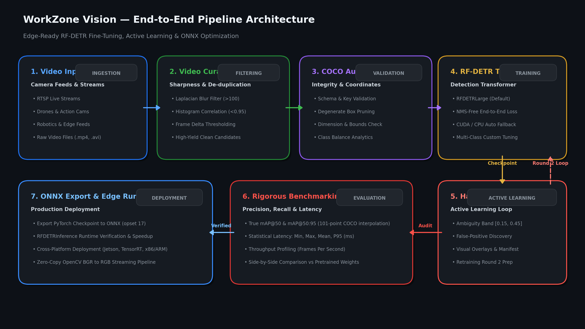

# WorkZone Vision

[](LICENSE)
[](https://www.python.org/downloads/)
[](.github/workflows/ci.yml)
[-orange.svg)](https://github.com/roboflow/rf-detr)
[](pyproject.toml)

> **Edge-ready real-time object detection fine-tuning, active learning, hard-negative mining, and ONNX optimization pipeline powered by Apache-2.0 RF-DETR.**

Author: **sivanandan21** ([sivapn721@gmail.com](mailto:sivapn721@gmail.com))

---

## 🌟 Why RF-DETR? (The Permissive All-Rounder Model)

Traditional object detection workflows frequently rely on YOLO models (e.g., YOLOv8, YOLO11), but those are governed by restrictive **AGPL-3.0** licenses that limit commercial and proprietary deployment. 

**RF-DETR** (Real-Time Detection Transformer, developed by Roboflow based on RT-DETR) is a modern, state-of-the-art **all-rounder foundation detector**:

| Feature | RF-DETR (WorkZone Vision) | YOLO (v8 / v11) |
| :--- | :--- | :--- |
| **Architecture** | **Transformer-based (NMS-free end-to-end)** | CNN-based with post-processing NMS |
| **License** | **Apache-2.0** (Commercially friendly) | AGPL-3.0 (Viral copyleft restrictions) |
| **Speed & Latency** | **Real-time edge inference** (TensorRT / ONNX) | Real-time edge inference |
| **Pretrained Weights** | **COCO 80 classes out-of-the-box** | COCO 80 classes out-of-the-box |
| **Domains** | **Any** camera feed, drone, robotics, live RTSP, edge | Any camera feed |
| **Fine-Tuning** | Single-class or multi-class custom datasets | Single-class or multi-class |

**WorkZone Vision** packages this all-rounder foundation model into a production-grade active learning and deployment pipeline for any video stream, live camera feed, or image dataset.

---

## 🏗️ Pipeline Architecture & Capabilities



This project implements an end-to-end machine learning engineering lifecycle:

```
Raw Video / Stream ──> [ Frame Quality Filter ] ──> [ Dataset Validator ] ──> [ RF-DETR Fine-Tuning ]
                               │                                                       │
                               ▼                                                       ▼
                      (Blur & Duplicate Drops)                                 (PyTorch Checkpoint)
                                                                                       │
                                                                                       ▼
[ Production Deployment ] <── [ ONNX Runtime Export ] <── [ Accuracy Benchmark ] <── [ Hard-Negative Mining ]
                                (Cross-Platform Speed)     (mAP@50, mAP@50:95)        (Ambiguity Discovery)
```

### 1. Computer Vision & Automated Video Curation
- **Laplacian Variance Blur Filtering**: Automatically drops motion-blurred frames (`blur_score < blur_threshold`) to keep training datasets crisp and prevent detector degradation.
- **Histogram Correlation & Pixel Delta De-duplication**: Rejects redundant static background frames (`change_pct < 1.5%` or correlation `>= 0.95`), cutting down dataset size and training costs without losing visual diversity.
- **Color Space Integrity**: Strictly maintains BGR-to-RGB conversion pipelines between OpenCV and Deep Learning inference backends.

### 2. Dataset Engineering & COCO Validation
- **Deep COCO Schema Verification**: Validates `images`, `annotations`, and `categories` in JSON files.
- **Coordinate & Bounding Box Auditing**: Detects degenerate zero-area boxes, out-of-bounds annotations, and dimension mismatches against physical images.
- **Class Distribution Analytics**: Summarizes box size distributions (small `<32px`, medium `32-96px`, large `>96px`) and background images.

### 3. Transfer Learning & Fine-Tuning
- **Multi-Class Support**: Train on any target classes (e.g., `["person", "head"]`, `["vehicle", "license_plate"]`, `["helmet", "vest"]`, or industrial defect classes).
- **Hardware-Aware Training**: Automatically configures PyTorch CUDA hardware acceleration with safe fallback to CPU, dynamic batch sizing, and gradient accumulation.
- **Early Stopping**: Prevents overfitting on custom domains with configurable patience.

### 4. High-Accuracy Inference Engine (`WorkZoneEnhancedPredictor`)
- **Low-Light & Glare Preprocessing (CLAHE)**: Evaluates L-channel histogram equalization in LAB color space to reveal underexposed silhouettes and mitigate window glare.
- **Sliced / Tiled Inference**: Decomposes high-resolution frames (1080p/4K) into overlapping 640x640 windows to detect tiny, far-corner objects that single-pass detectors overlook.
- **Test-Time Augmentation (TTA)**: Evaluates normal and horizontally flipped images with automatic coordinate un-flipping.
- **Pure-NumPy Weighted Boxes Fusion (WBF)**: Merges overlapping predictions from full-frame + tiles + TTA into tighter, high-confidence bounding boxes, significantly outperforming standard Non-Maximum Suppression (NMS) in dense or occluded scenes.

### 5. Active Learning & Hard-Negative Mining
- **Ambiguity Detection**: Filters model predictions in uncertainty windows (e.g., confidence `0.15` to `0.45`) where the detector is unsure.
- **False-Positive Extraction**: Discovers challenging background objects (reflections, chairs, clothing, clutter) that trigger false alarms.
- **Review Manifest Generation**: Produces visual overlays and a JSON manifest ready for immediate re-labeling and Round 2 iterative retraining.

### 6. Rigorous Benchmarking & 3-Way Metrics
- **Zero Placeholders**: Computes true COCO-standard `mAP@50` and `mAP@50:95` across 10 IoU thresholds using 101-point interpolated precision-recall curves.
- **Small-Object Recall Metric**: Measures exact recall on targets `< 32x32px` to verify edge resolution enhancements.
- **Statistical Latency Profiling**: Measures Warmup passes, Min, Max, Mean, P95 latency (ms), and FPS throughput on target hardware.
- **3-Way Comparison Engine**: Generates side-by-side terminal comparison tables showing absolute improvement deltas of WorkZone Max-Accuracy vs. Fine-Tuned vs. Stock baseline.

### 7. Edge Deployment & Optimization
- **ONNX Graph Export**: Direct export of trained PyTorch checkpoints to optimized ONNX graphs (`opset 17`).
- **ONNX Runtime Verification**: Loads exported artifacts via `RFDETRInference` to verify numerical consistency and measure deployment speedup.

### 8. Modern Python Packaging & MLOps
- Standard `pyproject.toml` configuration with console script entry point `workzone`.
- Pydantic v2 data models with runtime validation.
- Interactive terminal UI using Rich tables, panels, and progress bars.
- Automated GitHub Actions CI workflow running multi-version matrix tests.

---

## 📁 Repository Structure

```
workzone-vision/
├── configs/
│   └── config.yaml               # Pipeline hyperparameters and thresholds
├── data/
│   ├── raw_videos/.gitkeep       # Input video recordings (.mp4, .avi, etc.)
│   ├── extracted_frames/.gitkeep # Curated sharp candidate frames
│   ├── dataset/.gitkeep          # Labeled COCO dataset (train, val, test)
│   └── hard_negatives/.gitkeep   # Mined ambiguous/false-positive frames
├── models/
│   ├── checkpoints/.gitkeep      # Fine-tuned PyTorch checkpoints (.pt/.pth)
│   └── exported/.gitkeep         # Exported ONNX models (.onnx)
├── src/
│   ├── __init__.py
│   ├── config.py                 # Pydantic v2 schemas and model whitelist
│   ├── model_factory.py          # Model and inference predictor factory
│   ├── download_model.py         # Model download & verification routine
│   ├── extract_frames.py         # Laplacian blur & duplicate scene filter
│   ├── preprocess.py             # Low-light & glare CLAHE enhancement
│   ├── enhanced_inference.py     # Slicing, TTA, and Weighted Boxes Fusion
│   ├── validate_dataset.py       # COCO structure and box geometry validator
│   ├── train_finetune.py         # Model fine-tuning execution
│   ├── mine_hard_negatives.py    # Hard-negative & ambiguous detection miner
│   ├── evaluate.py               # 3-way benchmark (mAP, small-object recall, latency)
│   └── export_model.py           # ONNX export and runtime verification
├── tests/
│   └── test_smoke.py             # Pytest test suite (29 tests)
├── .github/
│   └── workflows/ci.yml          # GitHub Actions CI matrix
├── cli.py                        # Unified command-line interface
├── pyproject.toml                # Project packaging and entry points
├── requirements.txt              # Pinned requirements
├── LICENSE                       # Apache-2.0 License
└── README.md                     # Documentation
```

---

## 🚀 Quickstart & CLI Commands

### Installation
```bash
git clone https://github.com/sivanandan21/workzone-vision.git
cd workzone-vision

# Create and activate virtual environment (Python 3.10–3.12 recommended)
python -m venv .venv

# Linux / macOS:
source .venv/bin/activate

# Windows:
.venv\Scripts\activate

pip install -e .
```

All commands can be invoked via the global CLI alias `workzone` or `python cli.py`:

```bash
workzone --help
```

### 1. Download Foundation Weights
Fetch official weights for the default flagship model `RFDETRLarge` (or `RFDETRNano`, `RFDETRSmall`, `RFDETRMedium`):
```bash
workzone download --model-name RFDETRLarge
```

### 2. Extract & Filter Video Frames
Curate sharp, non-duplicate candidate frames from raw video clips or camera streams in `data/raw_videos/`:
```bash
workzone extract-frames --video-dir data/raw_videos --frame-interval 15 --blur-threshold 100.0
```
- Drops blurry frames (`blur_score < blur_threshold`).
- Drops static scenes (`change_pct < 1.5%` or histogram correlation `>= 0.95`).

### 3. Validate Dataset Integrity
Audit COCO labels before launching training:
```bash
workzone validate-dataset --dataset-dir data/dataset --classes person
```

### 4. Fine-Tune on Custom Domain
Fine-tune the detector on your labeled dataset:
```bash
workzone train --model-name RFDETRLarge --epochs 30 --batch-size 2 --lr 0.00008
```

### 5. Mine Hard Negatives (Active Learning Loop)
Uncover ambiguous detections (confidence `0.15`–`0.45`) to prepare Round 2 retraining data:
```bash
workzone mine-negatives --input-dir data/extracted_frames --min-conf 0.15 --max-conf 0.45
```

### 6. Benchmark Accuracy & Latency (3-Way Comparison)
Evaluate mAP and inference speed comparing pretrained baseline vs. fine-tuned vs. WorkZone Max-Accuracy engine:
```bash
workzone evaluate --model-name RFDETRLarge --checkpoint models/checkpoints/best.pt --enhanced
```
Runs a 3-way evaluation on `data/dataset/test`:
1. **Stock Pretrained `RFDETRLarge`** (Baseline)
2. **Fine-Tuned `RFDETRLarge`** (Single Pass)
3. **WorkZone Max-Accuracy** (Fine-Tuned + CLAHE + Sliced Inference + TTA + WBF)

Options:
- `--enhanced / --no-enhanced`: Toggle 3-way comparison with Max-Accuracy engine
- `--tiling / --no-tiling`: Enable/disable 640x640 sliced inference for tiny far-field objects
- `--tta / --no-tta`: Enable/disable horizontal test-time augmentation

### 7. Export to ONNX & Verify
Export the fine-tuned model for production edge deployment:
```bash
workzone export --checkpoint models/checkpoints/best.pt --model-name RFDETRLarge
```

### 8. End-to-End Pipeline
Run the full active learning pipeline sequentially:
```bash
workzone pipeline --model-name RFDETRLarge
```

---

## 🧪 Testing

Run the automated test suite with pytest:
```bash
pytest -v
```

All 29 smoke tests verify:
- Architecture whitelist enforcement (`RFDETRNano`, `RFDETRSmall`, `RFDETRMedium`, `RFDETRLarge`)
- Laplacian variance blur metric differentiation
- Frame differencing and histogram correlation
- Low-light CLAHE adaptive histogram equalization
- Multi-scale image slicing and coordinate remapping
- Pure-NumPy Weighted Boxes Fusion (WBF)
- WorkZoneEnhancedPredictor end-to-end inference pass
- COCO dataset schema and geometry validation
- Bounding box IoU calculations
- 101-point interpolated Average Precision mathematics
- OpenCV BGR-to-RGB color space conversions

---

## 🌐 Real-World Application Domains

Because RF-DETR is an all-rounder foundation detector, WorkZone Vision seamlessly applies across diverse industries:

- **Workplace Safety & PPE**: Person detection, hard hat compliance, high-visibility vest verification.
- **Smart Cities & Traffic**: Vehicle tracking, pedestrian detection, bicycle counting from traffic cameras.
- **Robotics & Drones**: Real-time obstacle and human detection for autonomous mobile robots (AMRs) and aerial feeds.
- **Retail & Security**: Customer foot-traffic analytics, queue monitoring, restricted zone boundary alerts.
- **Manufacturing & Logistics**: Package detection, conveyor belt monitoring, machinery safety perimeter guards.

---

## 📜 Third-Party Attributions

- **[RF-DETR](https://github.com/roboflow/rf-detr)** (Apache-2.0 License): Real-time detection transformer model architectures.
- **[Supervision](https://github.com/roboflow/supervision)** (MIT License): Computer vision utilities and detection data structures.
- **[OpenCV](https://opencv.org/)** (Apache-2.0 License): Image and video processing.
- **[ONNX Runtime](https://onnxruntime.ai/)** (MIT License): High-performance cross-platform ML inference engine.
- **[PyTorch](https://pytorch.org/)** (Modified BSD License): Deep learning framework.
- **[Typer](https://typer.tiangolo.com/)** & **[Rich](https://github.com/Textualize/rich)** (MIT License): Command-line interface and terminal formatting.

---

## 📄 License

This project is licensed under the **Apache License, Version 2.0**. See the [LICENSE](LICENSE) file for details.
